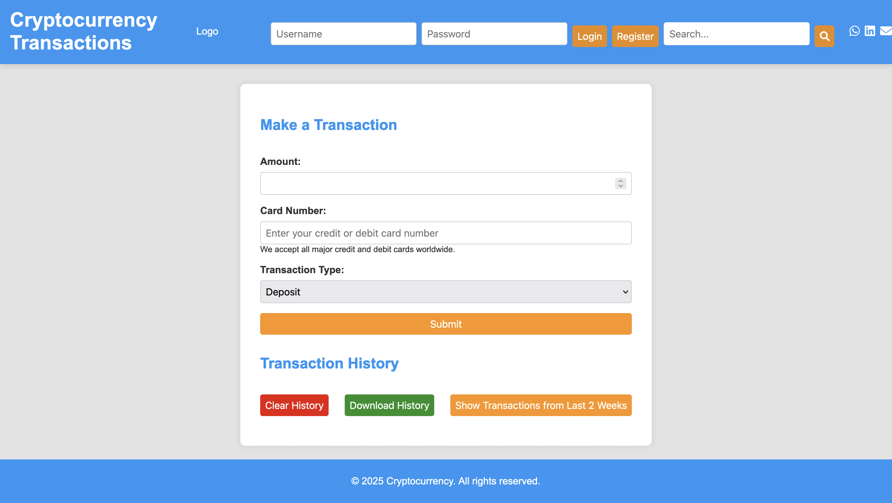

# 🌟 Welcome to My GitHub Profile! 🌟 

### 👋 Hi, I’m **Farida Bano**!  

I am a passionate Web Developer and aspiring UI/UX Designer.  
🤖 **AI Integration Engineer | Full Stack Developer**  
📍 Building intelligent apps with **Python & Next.js**  
🔧 Specializing in **AI SDKs & Agent frameworks**  
🎓 **GIAIC Governor Sindh** | AI & Cloud Technologies

**📍 Location:** Karachi, Pakistan  
---
## 🧰 Tech Stack & Skills  

| 💻 Development | 🎨 Design & Tools | 🌐 Other Skills |
| :--- | :--- | :--- |
| HTML, CSS, JavaScript | Figma, Canva | UI/UX Design |
| TypeScript, Next.js | Shadcn (React Components) | Art & Craft (Crochet) |
| Tailwind CSS, Python | Prompt Engineering | Agent Systems |
| AI SDKs, Qwen Cloud | Docusaurus | Gemini |
---

## 📋 What I Do  
- 🌱 **Currently Learning**: Advanced Web Development, TypeScript, Next.js, Tailwind CSS, and AI Integrations. 
- 💞️ **Looking to collaborate**: UI/UX design projects. 
- 🎨 **Fun Fact**: I enjoy art & craft, including crochet work & knitting.
- 📘 **Author**: *"Modern AI Tools: SpeakItPlus to Gemini CLI"*

---
## 🚀 Project Highlights  

### 💳 Fintech Web Application (Feature Preview)

**Project Overview:** 
I developed a comprehensive fintech web application divided into four key phases:
- **Phase 1 (Auth):** Implemented a secure user login and registration system with username, password, a search bar, and social media links.
- **Phase 2 (Transactions):** Created a feature for users to enter the amount, card number, transaction type, and submit transactions securely.
- **Phase 3 (History):** Added functionality to view, clear, and download transaction history, with filtering options for the last two weeks.
- **Phase 4 (UI):** Designed a complete, responsive layout with a polished footer.

 

### 📂 Project Links  
- **Live Preview**: [View Live Project](https://example.com)  
- **Source Code**: [GitHub Repository](https://github.com/username/repository)  

---

## 🎓 About My Education  

I am currently studying at the **Governor Initiative for Gen AI, Web 3.0, and Metaverse** in Karachi, Pakistan.  
I am enthusiastic about combining my coding and design skills to create beautiful, functional, and intelligent projects.

---

## 🔗 Connect with Me

 
 

---

## ❤️ Thank You for Visiting!  

If you like my work, feel free to ⭐ my repositories and connect with me. 😊  

  
  

